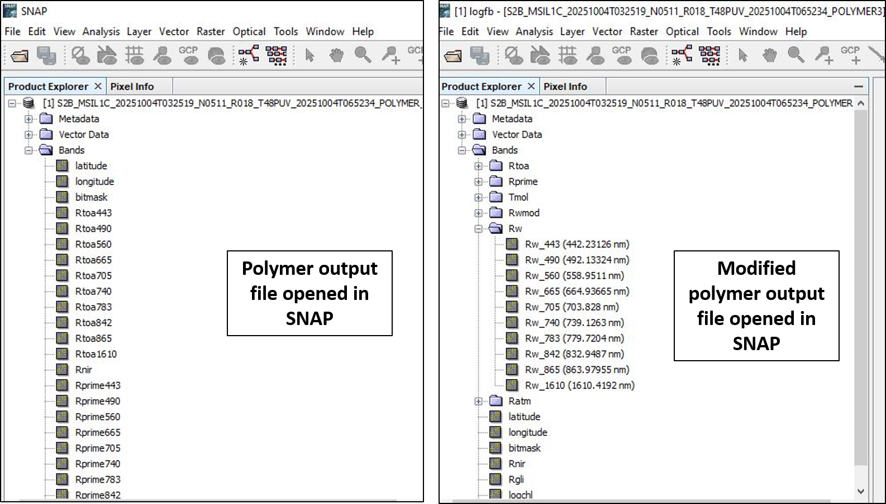
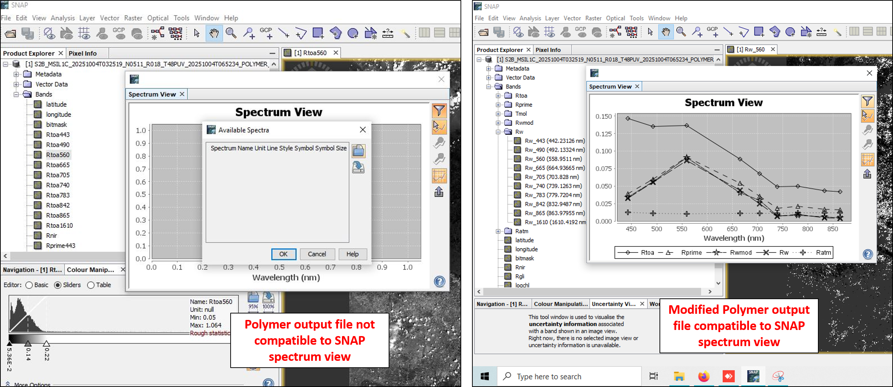

# SNAP-Compatible NetCDF Output

## Overview

This fork extends POLYMER's NetCDF output writer to improve compatibility with ESA SNAP (Sentinel Application Platform).

The modifications improve the organization and interpretation of POLYMER output products in SNAP, particularly spectral band grouping, wavelength metadata, and spatial dimensions.

**The modifications are restricted to NetCDF output generation. POLYMER's atmospheric-correction algorithms, retrieval calculations, and scientific processing methodology remain unchanged.**

## Modifications

### 1. NetCDF format

- Changed the output format from `NETCDF4_CLASSIC` to `NETCDF4`.
- Added BEAM-compatible metadata to improve SNAP product interpretation.

### 2. Spectral variable naming

Spectral variables use an underscore-separated naming convention.

Examples:

- `Rtoa_443`
- `Rprime_443`
- `Tmol_443`
- `Rw_443`

The original POLYMER parameter names are preserved.

### 3. Automatic band grouping

The NetCDF global attribute `auto_grouping` is used to organize spectral variables into logical groups in SNAP.

The output includes the following groups:

- `Rtoa`
- `Rprime`
- `Tmol`
- `Rwmod`
- `Rw`
- `Ratm`

This makes it easier to browse and inspect the different POLYMER output parameters within SNAP.

### 4. Spectral wavelength metadata

Spectral wavelengths are obtained from POLYMER's Sentinel-2 spectral response functions (SRFs), using the equivalent central wavelength calculated during sensor initialization.

The corresponding wavelength information is written to individual spectral variables.

This ensures that the wavelength metadata reflects the sensor-specific spectral response rather than relying on nominal band centre values.

## Compatibility

The modified NetCDF products have been tested in ESA SNAP.

The following output characteristics have been checked:

- Spectral wavelength metadata.
- Automatic spectral band grouping.
- Spatial dimension interpretation.
- Product opening and visualization in SNAP.

## Scope of Changes

These modifications concern the NetCDF output interface only.

No changes have been made to:

- Atmospheric correction algorithms.
- Water-leaving reflectance retrieval.
- Optimization or convergence procedures.
- POLYMER's scientific processing methodology.

The objective is to improve output interoperability with SNAP while preserving POLYMER's original scientific functionality.

## Acknowledgement

This work is based on the original POLYMER atmospheric correction processor. The modifications in this fork focus on NetCDF output compatibility with ESA SNAP.
 

## Licencing information

This software is available under the Polymer licence v2.0, available in the
LICENCE.TXT file.

## Referencing

When acknowledging the use of Polymer for scientific papers, reports etc please
cite the following reference:

* François Steinmetz, Pierre-Yves Deschamps, and Didier Ramon, "Atmospheric
  correction in presence of sun glint: application to MERIS", Opt. Express 19,
  9783-9800 (2011), http://dx.doi.org/10.1364/OE.19.009783

* François Steinmetz and Didier Ramon "Sentinel-2 MSI and Sentinel-3 OLCI consistent
  ocean colour products using POLYMER", Proc. SPIE 10778, Remote Sensing of the Open
  and Coastal Ocean and Inland Waters, 107780E (30 October 2018); https://doi.org/10.1117/12.2500232

